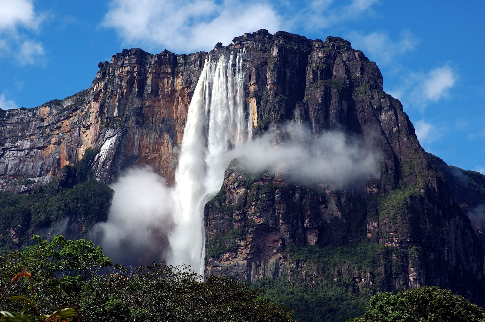
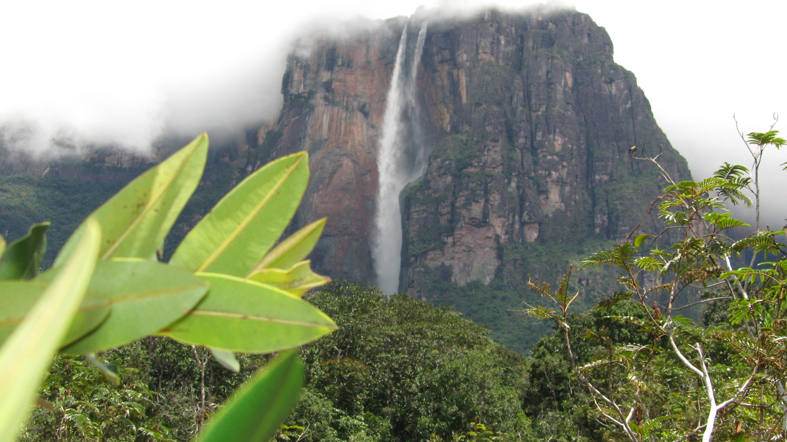
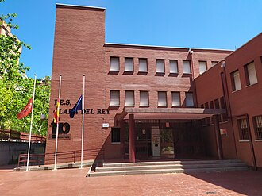

# Venzuela: un pais por descurbir

## Introduccion

**Venezuela** es un pais situado en America del Sur, conocido por su *diversidad natural*, su cultura y sus paisajes.

En esta pagina descubriremos algunos de sus lugares mas emblematicos. Tambien aprendermos a utilizar `Mrkdownm` para crear docuemtacion organizada

## Destinos turisticos de Venzuela
### Lugares que debes conocer

1. Salto Angel
2. los Roques
3. Merida
4. Parque Nacional Canaima
5. Isla de Margarita

### ¿Qué ofrece Venzuela?

- Playas del mar Caribe
- Montañas y paisajes andinos

## Ejemplo de comandos Linux
```bash
mkadir fotos-Venezuela
cd fotos-Venezuela
mkadir playas montanas y ciudades
ls
```

## Principales dstinos turisticos
| Destino |Estado | Atractivo principal |
|---|---|---|
|Salto Angel | Bolivar | Cascada natural|
|Los Roques| Dependecias Federales | Playas e islas|
|Merida | Merida | Motanas andinas|
|Islas de Margarita |Nueva Esparta | Playas y turismo |
|Parque Nacioanles Morrocy | Falcon | Cayos y playas |

## Enlaces de interes

para conocermas sobre nuestro pais, puedes visitar la 
[enciclopedia de Venezuela de Wikipedia](https://es.wikipedia.org/wiki/Venezuela).

Tambien puedes consultar nuestra
[guia de destino turismo](docs/detalles.md),
donde encontraras informacion adicional sobre los lugares mas interesantes

## Galeria de paisaje venezolanos

### El Salto Angel

El Salto Angel es unos de los paisajes naturales mas emblematicos de Venzuela




### Parque nacional Nacional Canima

El parque Nacional Canaima destaca por sus paisajes naturales y sus tepuyes



## Centro educativo

Este proyecto se realiza como parte de una práctica de Markdown del IES Clara del Rey, situado en Madrid.


Fotografía: ANAGSPC. [wikimedia Commos](https://commons.wikimedia.org/wiki/File:I.e.s._clara_del_rey_(Prosperidad,_Madrid).jpg). Licenciada [CC BY-SA 4.0](https://creativecommos.org/licenses/by-sa/4.0/). 


### Clara del Rey: origen del nombre del instituto

Clara del Rey fue una figura histórica vinculada al levantamiento del 2 de mayo de 1808 en Madrid.


Fotografía: Juan Golben. [Wikimedia Commons](https://commons.wikimedia.org/wiki/File:Monumento_de_Clara_del_Rey_obra_del_escultor_C%C3%A9sar_Orrico_01.jpg). Licencia [CC BY-SA 4.0](https://creativecommons.org/licenses/by-sa/4.0/).


### Fotografía externa del IES Clara del Rey

Esta fotografía del instituto se muestra directamente desde Wikimedia Commons mediante una URL externa.


Fotografía: ANAGSPC. [Wikimedia Commons](https://commons.wikimedia.org/wiki/File:I.e.s._clara_del_rey_(Prosperidad,_Madrid).jpg). Licencia [CC BY-SA 4.0](https://creativecommons.org/licenses/by-sa/4.0/).
